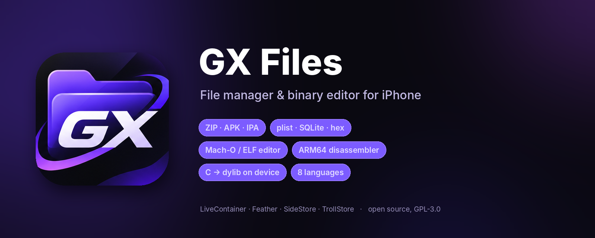
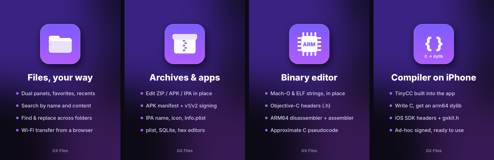

<p align="center"></p>

<p align="center">
  <a href="README.md">English</a> ·
  <b>Русский</b> ·
  <a href="README.uk.md">Українська</a> ·
  <a href="README.be.md">Беларуская</a> ·
  <a href="README.de.md">Deutsch</a> ·
  <a href="README.fr.md">Français</a> ·
  <a href="README.es.md">Español</a> ·
  <a href="README.pt-BR.md">Português</a>
</p>

<p align="center">
  <a href="../../releases/latest"></a>
  <a href="../../actions"></a>
  
  
</p>

**GX Files** — нативный файловый менеджер для iPhone со встроенным редактором архивов, APK/IPA и бинарников, а также компилятором C, который собирает dylib прямо на телефоне. Работает как обычное приложение (Feather, SideStore, AltStore, TrollStore) и внутри [LiveContainer](https://github.com/khanhduytran0/LiveContainer).

## Установка

**Добавь источник** в Feather, SideStore или AltStore — обновления будут приходить сами:

```
https://raw.githubusercontent.com/GRAFXXX/GX-Files/main/source/apps.json
```

**Или скачай** `GXFiles.ipa` из [Releases](../../releases/latest) и установи любым способом.

| Как установлено | Что доступно |
|---|---|
| Feather / SideStore / AltStore | «Мои файлы» (также в «Файлах» → «На iPhone» → GX Files), подключённые папки, файлы через «Поделиться» |
| LiveContainer | всё выше + общая папка LiveContainer, данные гостевых приложений, твики |
| TrollStore / джейлбрейк | вся файловая система |

## Возможности

**Файлы**
- Две панели, избранное, недавние, скрытые файлы, миниатюры
- Копирование, перемещение, символические ссылки, пакетное переименование по шаблону
- Поиск по имени и содержимому, поиск дубликатов, анализ места
- Поиск и замена текста или hex во всей папке — даже внутри ZIP/APK/IPA без распаковки
- Передача файлов по Wi‑Fi через браузер на компьютере
- «Открыть в GX Files» через «Поделиться»; apk, dylib, so, dex и btx открываются в GX Files из «Файлов»
- Сетевые диски по WebDAV — компьютер, NAS, Nextcloud; клиент GitHub: смотреть, скачивать, править и коммитить с телефона

**Форматы**
- ZIP, APK, IPA, JAR — правка прямо в архиве; чтение tar, 7z, rar и других
- Текстовый редактор с подсветкой, hex-редактор, plist / JSON / .strings, SQLite с SQL-консолью
- APK: разбор бинарного манифеста, подпись v1 + v2
- IPA: название, bundle ID, иконка, Info.plist, ограничения устройств, расширения
- Игровые текстуры (.btx / .dds / SHTX), Assets.car, профили подписи

**Редактор бинарников (Mach-O / ELF)**
- Строки — поиск и правка на месте, ссылки из кода
- Классы Objective-C → заголовки .h
- Дизассемблер ARM64, приблизительный псевдокод на C, встроенный ассемблер
- Эмулятор ARM64: пошаговое выполнение функции в песочнице с просмотром регистров
- Псевдокод со структурами if/else/while, а не только goto
- Аудит безопасности (SAST): находит strcpy/sprintf/system, MD5/SHA-1, отключённые проверки TLS
- Числа и константы, встроенные картинки и шрифты, цвета интерфейса
- Переподпись ad-hoc после правки

**Компилятор на телефоне** — [TinyCC](https://github.com/TinyCC/tinycc) с заголовками iOS SDK и помощником `gxkit.h`: пишешь на C — получаешь arm64 dylib.

**8 языков** — English, Русский, Українська, Беларуская, Deutsch, Français, Español, Português (Brasil).

## Скриншоты

<p align="center"></p>

Настоящие скриншоты — скоро.

## Сборка

**macOS (Xcode):**
```sh
python3 -m pip install pillow
bash build.sh
```

**Linux:** нужны `clang`, `lld`, `zip`, Python 3 с Pillow и iPhoneOS SDK:
```sh
SDK=/путь/к/iPhoneOS.sdk bash build.sh
```

Результат — `GXFiles.ipa`. Заголовки для встроенного компилятора генерируются из твоего SDK при первой сборке (`tools/sdk/make_sdk.py`), файлов Apple в репозитории нет. На macOS сборка также делает светлую, тёмную и тонированную иконку (iOS 18+).

Каждое изменение собирает GitHub Actions; тег `v*` публикует релиз и обновляет источник для Feather / SideStore.

## Участие

Сообщения об ошибках, идеи и переводы приветствуются — см. [CONTRIBUTING.md](CONTRIBUTING.md). Новый язык — это один файл.

## Ответственное использование

Редактор бинарников и компилятор нужны для изучения, отладки и правки **своих** приложений и приложений, на изменение которых у тебя есть право. Не используй GX Files для нарушения лицензий, обхода защиты или нечестной игры в чужих сервисах и онлайн-играх.

## Лицензия

[GNU GPL v3](LICENSE). Встроенный TinyCC — LGPL 2.1, см. [THIRD_PARTY.md](THIRD_PARTY.md).
